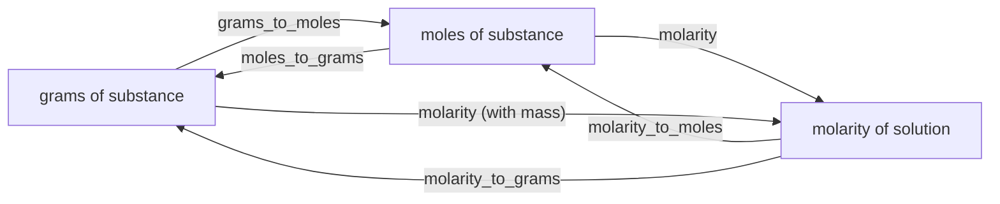

# conversions

The `conversions` module moves between the three quantities at the center of
stoichiometry: **grams**, **moles** and **molarity**.

```pycon
>>> from chemhelper import conversions
```



| Function | Converts | Twin that prints the solution |
| --- | --- | --- |
| [`grams_to_moles`](#grams_to_moles) | grams → moles | [`grams_to_moles_steps`](#grams_to_moles_steps) |
| [`moles_to_grams`](#moles_to_grams) | moles → grams | [`moles_to_grams_steps`](#moles_to_grams_steps) |
| [`molarity`](#molarity) | moles (or grams) and volume → molarity | [`molarity_steps`](#molarity_steps) |
| [`molarity_to_moles`](#molarity_to_moles) | molarity and volume → moles | [`molarity_to_moles_steps`](#molarity_to_moles_steps) |
| [`molarity_to_grams`](#molarity_to_grams) | molarity and volume → grams | [`molarity_to_grams_steps`](#molarity_to_grams_steps) |

!!! info "Units on this page"
    Mass is in **grams**, amount in **moles**, volume in **liters** and
    concentration in **moles per liter (M)**. To use milliliters, divide by
    1000 first. See [Units and rounding](../getting-started/units-and-rounding.md).

---

## `grams_to_moles`

```python
conversions.grams_to_moles(mass, chemical)
```

Converts a mass of a substance to moles.

**Arguments**

| Name | Type | Description |
| --- | --- | --- |
| `mass` | number | Mass of the sample in grams |
| `chemical` | `str` | Chemical formula of the substance |

**Returns**

A `float`: the number of moles, rounded to 2 decimals.

**Raises**

`ValueError` if the formula cannot be read.

**How it is calculated**

\[
n = \frac{m}{M}
\]

where \(m\) is the mass in grams and \(M\) is the molar mass from
[`compounds.mass`](compounds.md#mass).

**Examples**

```pycon
>>> conversions.grams_to_moles(36.04, 'H2O')
2.0
>>> conversions.grams_to_moles(100, 'NaCl')
1.71
>>> conversions.grams_to_moles(45.0, 'C6H12O6')
0.25
```

!!! warning "Small samples round to zero"
    The result has two decimals, so anything under 0.005 mol becomes `0.0`.
    For small samples divide by the molar mass yourself:

    ```pycon
    >>> from chemhelper import compounds
    >>> conversions.grams_to_moles(0.05, 'C6H12O6')
    0.0
    >>> round(0.05 / compounds.mass('C6H12O6'), 6)
    0.000278
    ```

---

## `grams_to_moles_steps`

```python
conversions.grams_to_moles_steps(mass, chemical)
```

Prints the conversion as a single dimensional-analysis line: the mass, times
one mole over the molar mass.

**Arguments**

The same as [`grams_to_moles`](#grams_to_moles).

**Examples**

```pycon
>>> conversions.grams_to_moles_steps(36.04, 'H2O')
36.04g H2O x 1 mole H2O/18.02g H2O = 2.0 moles H2O
>>> conversions.grams_to_moles_steps(100, 'NaCl')
100g NaCl x 1 mole NaCl/58.44g NaCl = 1.71 moles NaCl
```

---

## `moles_to_grams`

```python
conversions.moles_to_grams(moles, chemical)
```

Converts moles of a substance to grams.

**Arguments**

| Name | Type | Description |
| --- | --- | --- |
| `moles` | number | Amount of substance in moles |
| `chemical` | `str` | Chemical formula of the substance |

**Returns**

A `float`: the mass in grams, rounded to 2 decimals.

**Raises**

`ValueError` if the formula cannot be read.

**How it is calculated**

\[
m = n \times M
\]

**Examples**

```pycon
>>> conversions.moles_to_grams(2, 'H2O')
36.04
>>> conversions.moles_to_grams(0.25, 'NaCl')
14.61
>>> conversions.moles_to_grams(1.5, 'CO2')
66.02
```

---

## `moles_to_grams_steps`

```python
conversions.moles_to_grams_steps(moles, chemical)
```

Prints the molar mass calculation, then the moles times the molar mass.

**Arguments**

The same as [`moles_to_grams`](#moles_to_grams).

**Example**

```pycon
>>> conversions.moles_to_grams_steps(0.25, 'NaCl')
NaCl
Na: 22.99
Cl: 35.45

Mass NaCl = 22.99 + 35.45 = 58.44
0.25 moles x 58.44 grams/mole = 14.61 grams
```

---

## `molarity`

```python
conversions.molarity(volume, mass=None, chemical=None, moles=None)
```

The molarity of a solution: moles of solute per liter of solution.

There are two ways to call it:

- give the **moles** of solute, or
- give the **mass** of solute together with its **formula**.

**Arguments**

| Name | Type | Description |
| --- | --- | --- |
| `volume` | number | Volume of the **solution** in liters |
| `mass` | number, optional | Mass of solute in grams |
| `chemical` | `str`, optional | Formula of the solute. Required with `mass`. |
| `moles` | number, optional | Moles of solute |

If you give `moles`, then `mass` and `chemical` are ignored.

**Returns**

A `float`: the molarity in mol/L. It is not rounded.

**Raises**

`ValueError` if you give neither `moles` nor both `mass` and `chemical`, or
if the formula cannot be read.

**How it is calculated**

\[
M = \frac{n}{V}
\]

With a mass, the moles are found first as \(n = m / M_\text{molar}\).

**Examples**

From moles:

```pycon
>>> conversions.molarity(0.5, moles=1)
2.0
>>> conversions.molarity(2, moles=0.5)
0.25
```

From a mass of solute:

```pycon
>>> conversions.molarity(2, mass=58.44, chemical='NaCl')
0.5
>>> conversions.molarity(0.25, mass=10, chemical='NaOH')
1.0
```

`volume` is the first argument, so name the others:

```pycon
>>> round(conversions.molarity(volume=0.1, mass=4.9, chemical='H2SO4'), 3)
0.5
```

Volumes in milliliters need converting:

```pycon
>>> conversions.molarity(250 / 1000, mass=10, chemical='NaOH')
1.0
```

Leaving out the formula is an error:

```pycon
>>> conversions.molarity(1, mass=10)
Traceback (most recent call last):
  ...
ValueError: Give either moles, or both mass and chemical.
```

---

## `molarity_steps`

```python
conversions.molarity_steps(volume, mass=None, chemical=None, moles=None)
```

Prints the molarity calculation. If you give a mass, the grams-to-moles
conversion is printed first.

**Arguments**

The same as [`molarity`](#molarity).

**Examples**

```pycon
>>> conversions.molarity_steps(0.25, mass=10, chemical='NaOH')
10g NaOH x 1 mole NaOH/40.0g NaOH = 0.25 moles NaOH
0.25 moles/0.25 L = 1 M
```

```pycon
>>> conversions.molarity_steps(0.5, moles=1)
1 moles/0.5 L = 2 M
```

---

## `molarity_to_moles`

```python
conversions.molarity_to_moles(M, volume)
```

The moles of solute in a given volume of solution.

**Arguments**

| Name | Type | Description |
| --- | --- | --- |
| `M` | number | Concentration in mol/L |
| `volume` | number | Volume of solution in liters |

**Returns**

A `float`: moles of solute. It is not rounded.

**How it is calculated**

\[
n = M \times V
\]

**Examples**

```pycon
>>> conversions.molarity_to_moles(2, 0.5)
1.0
>>> conversions.molarity_to_moles(0.25, 0.1)
0.025
```

This function does not need to know what the solute is, so it takes no
formula.

---

## `molarity_to_moles_steps`

```python
conversions.molarity_to_moles_steps(M, volume)
```

Prints the molarity times the volume.

**Example**

```pycon
>>> conversions.molarity_to_moles_steps(2, 0.5)
2 moles/L x 0.5 L = 1 moles
```

---

## `molarity_to_grams`

```python
conversions.molarity_to_grams(molarity, volume, chemical)
```

The grams of solute in a given volume of solution. Use it to answer "how much
do I weigh out to make this solution?"

**Arguments**

| Name | Type | Description |
| --- | --- | --- |
| `molarity` | number | Concentration in mol/L |
| `volume` | number | Volume of solution in liters |
| `chemical` | `str` | Formula of the solute |

**Returns**

A `float`: the mass of solute in grams, rounded to 2 decimals.

**Raises**

`ValueError` if the formula cannot be read.

**How it is calculated**

\[
m = M \times V \times M_\text{molar}
\]

**Examples**

```pycon
>>> conversions.molarity_to_grams(0.5, 2, 'NaCl')
58.44
>>> conversions.molarity_to_grams(0.1, 0.25, 'NaOH')
1.0
>>> conversions.molarity_to_grams(1.0, 0.5, 'C6H12O6')
90.08
```

---

## `molarity_to_grams_steps`

```python
conversions.molarity_to_grams_steps(molarity, volume, chemical)
```

Prints the whole chain: molarity to moles, the molar mass, then moles to
grams.

**Arguments**

The same as [`molarity_to_grams`](#molarity_to_grams).

**Example**

```pycon
>>> conversions.molarity_to_grams_steps(0.5, 2, 'NaCl')
0.5 moles/L x 2 L = 1 moles
NaCl
Na: 22.99
Cl: 35.45

Mass NaCl = 22.99 + 35.45 = 58.44
1 moles x 58.44 grams/mole = 58.44 grams
```

---

## Combining conversions

The functions are designed to chain. Each returns a number the next one
accepts.

**Dilution.** 50 mL of 2.0 M HCl is diluted to 400 mL. What is the new
concentration? The moles of solute do not change, so find them, then divide
by the new volume:

```pycon
>>> moles = conversions.molarity_to_moles(2.0, 0.050)
>>> conversions.molarity(0.400, moles=moles)
0.25
```

**Grams of one substance to grams of another.** For
2 H₂ + O₂ → 2 H₂O, how many grams of water form from 8.0 g of H₂? Convert to
moles, apply the mole ratio from the balanced equation, and convert back:

```pycon
>>> moles_h2 = conversions.grams_to_moles(8.0, 'H2')
>>> moles_h2o = moles_h2 * 2 / 2
>>> conversions.moles_to_grams(moles_h2o, 'H2O')
71.36
```

chemhelper does not balance equations or read mole ratios for you. You supply
the ratio.

More worked problems are in the
[solutions tutorial](../tutorials/solutions.md) and the
[Cookbook](../cookbook.md).

## Common mistakes

**Using milliliters.** Every volume here is in liters. 250 mL is `0.25`.

**Using the volume of solvent.** Molarity is defined per liter of
**solution**, the final volume after the solute has dissolved.

**Passing `mass` without `chemical`.** `molarity` needs the formula to turn
grams into moles.

**Positional arguments in `molarity`.** The order is
`volume, mass, chemical, moles`. Naming the arguments, as in
`molarity(0.5, moles=1)`, avoids mixing them up.
